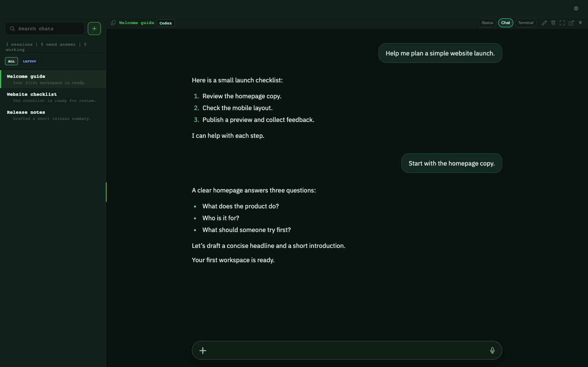

# Pentacle

**A control plane for your AI agents.**

Run a fleet of coding agents across machines, providers and accounts. They
share one memory, follow enforced process, and report to one always-on agent
you talk to.

## Core principles

1. **One fleet, any provider.** Claude, Codex, Cursor, Gemini and ChatGPT
   agents are interchangeable workers. The control plane is the constant.
2. **Memory outlives the session.** Shared memory, work specs and procedures
   live outside any single agent or context window. Every agent starts from
   the same truth.
3. **Work is tracked, not trusted.** Every task is a spec with a status,
   evidence and independent QA. Nothing is done because an agent said so.
4. **Rules are enforced, not prompted.** Roles, procedures, QA gates and usage
   limits are checked by the daemon. An agent cannot talk its way around them.
5. **Agents talk to agents.** Any agent can message, spawn, commission and
   report to any other agent in the fleet, on any machine.
6. **One point of contact.** An always-on assistant triages, delegates and
   answers. You never have to find the right agent.
7. **Manage from anywhere.** Web, mobile and voice. Read status, answer a
   question or approve from your phone.

## How it fits together

Each layer builds on the one below it.

| Layer | What it is | Included |
| --- | --- | --- |
| Hosts and accounts | Your machines, provider CLIs and pooled accounts | [Machines and `agent-orch` setup](docs/agent_orchestration_setup.md), [provider accounts](docs/provider_accounts.md), [usage accounting](docs/usage_accounting.md), outside agents such as a [ChatGPT Dot agent](docs/connect-a-dot-agent.md) or a [friend agent](docs/connect-a-friend-agent.md) |
| Shared memory | Work specs, procedures and evidence, synced to every host | [Process workspace](PROCESS.md) with spec templates, lifecycle directories and validation tools |
| Daemon | One Python daemon that runs sessions, spawns agents, carries messages and enforces the rules | [Communication contract](docs/communication_contract.md), [reports and assets](docs/report_assets.md), [governance tripwires](docs/governance_tripwires.md), [admission guards](docs/completion-admission-guards.md) |
| Work tracking | Work streams (lanes), specs, QA gates, evidence and dashboards | [Work lanes](docs/web_work_lanes.md), [specs dashboard](docs/specs_dashboard.md), [dashboards](docs/dashboards_view.md) |
| Assistant | The always-on agent you talk to: triage, delegation, follow-ups, durable questions | [Assistant](docs/assistant.md), [recovery](docs/assistant_recovery.md) and [transfer](docs/assistant_transfer.md) |
| Surfaces | Web, mobile, terminal and voice | [Pentacle Web](server/README.md), [Pentacle Mobile](https://github.com/HJK6/pentacle-mobile), [voice answers](docs/web_voice_answers.md), [room microphone](docs/room_mic_conversation.md) |

## See it

A single-machine example with invented sessions and conversation text.



More views: [New Chat and terminal screenshots](docs/screenshots.md), and the
[reports and assets showcase](docs/reports_showcase.md) for what agents
publish back to you.

## Quick start

The fastest route is to hand a coding agent [AGENT_SETUP.md](AGENT_SETUP.md).
It holds the full setup checklist. Keep your provider account ready; sign-in
and device approvals may need you.

The manual route is: install, issue a credential, start the daemon, serve
Pentacle Web.

**Prerequisites.** macOS or Linux, Node.js 22.12+, Python 3.11+, tmux, and at
least one signed-in agent CLI (`claude` or `codex`). On Windows run the daemon
and tmux inside WSL and set `localWsl` in the config, or point terminals at a
separate SSH host; the commands below assume a macOS, Linux or WSL shell.

**1. Install.** From this repository:

```sh
npm ci
python3 -m venv .venv
. .venv/bin/activate
python -m pip install -r services/chat-stream-v2/requirements.txt -e services/agent-orch
mkdir -p "$HOME/.config/pentacle" "$HOME/workspace"
chmod 700 "$HOME/.config/pentacle"
cp pentacle.config.example.js "$HOME/.config/pentacle/pentacle.config.js"
```

**2. Issue the web host's daemon credential** without printing it (the path
matches `chatStream.tokenPath` in the example config):

```sh
python services/chat-stream-v2/tools/operator_auth_cli.py issue --client-kind pentacle --label web |
  python -c 'import json,os,pathlib,sys; p=pathlib.Path.home()/".config/pentacle/desktop.token"; fd=os.open(p,os.O_WRONLY|os.O_CREAT|os.O_TRUNC,0o600); os.write(fd,json.load(sys.stdin)["code"].encode()); os.close(fd); p.chmod(0o600)'
```

**3. Start the daemon** in one terminal. `local` is the host identity in the
example config; provider binaries come from your PATH and transcripts stay in
each provider's native directory. Pick another port here and in the config if
7791 is taken.

```sh
python services/chat-stream-v2/main.py --host 127.0.0.1 --port 7791 \
  --local-host local --db "$HOME/.config/pentacle/sessions.db" \
  --claude-bin "$(command -v claude)" --codex-bin "$(command -v codex)" \
  --spawn-cwd "$HOME/workspace" --projects-root "$HOME/.claude/projects"
```

**4. Build and serve Pentacle Web** in another terminal, then open the printed
`http://127.0.0.1:7795` (install it as a PWA if you like):

```sh
npm run build:web
PENTACLE_CONFIG="$HOME/.config/pentacle/pentacle.config.js" node server --port 7795
```

Use **New Chat**, pick `local`, then a provider and model. Keep the daemon
running while any client is open. To reach Pentacle Web from other devices,
put it behind `tailscale serve` with Tailscale identity; [web host
setup](server/README.md) covers `--auth`, `--origin`, `--allow-login` and the
security boundary. For a phone, install
[Pentacle Mobile](https://github.com/HJK6/pentacle-mobile) against the same
daemon.

## Configuration

The private config (`$HOME/.config/pentacle/pentacle.config.js`) selects the
daemon URL and token path, host labels, terminal transports and optional
features; see the [configuration reference](docs/desktop_config.md). The token
must be a regular mode-0600 file in a mode-0700 directory with no symbolic-link
ancestors. Never commit credentials or runtime databases.

Sessions open in **Chat** by default; choose **Terminal** under Settings →
Default view. The workspace shows one to four panes and a first visit opens the
assistant chat ([workspace controls](docs/chat_first_workspace.md)). An
optional chat-first look is off by default; enable **Chat-first style** in
Settings or set `features.chatFirstStyle: true`.

More: [daemon setup and remote clients](services/chat-stream-v2/README.md),
[public support boundaries](docs/public_release.md).

## Repositories

| Repository | What it provides | Clone it? |
| --- | --- | --- |
| [pentacle](https://github.com/HJK6/pentacle) | Daemon, `agent-orch` CLI, process workspace and Pentacle Web | Yes, on the computer running your agents. |
| [pentacle-mobile](https://github.com/HJK6/pentacle-mobile) | Phone client | Only to build the phone app. |
| [pentacle-chat-core](https://github.com/HJK6/pentacle-chat-core) | Shared chat model and rendering library | No. Both clients vendor a copy in `pentacle-chat-core/`. Clone upstream only to work on the library. |

## Build and test

```sh
npm run prestart                          # all renderer bundles
npm test                                  # shared host and renderer tests
python -m pytest services/chat-stream-v2/tests
python -m pytest services/agent-orch/tests
```

The daemon tests exercise both Bash and Zsh remote shells; install both first
(`sudo apt-get install bash zsh` on Debian/Ubuntu). For the owned browser gate,
prerequisites and evidence boundaries, see [the E2E harness](docs/E2E_HARNESS.md).
The default Python suite excludes the long-running soak tier.
Tests that need real provider CLIs are opt-in with `PENTACLE_LIVE_TESTS=1`.

The certified daemon runner is `python services/chat-stream-v2/tools/run_gate.py merge`
from a clean Git checkout. It runs the unit and socket smoke tiers and writes
evidence outside the repository. On macOS its multi-bind preflight requires the
documented [loopback alias](services/chat-stream-v2/deploy/loopback-alias/README.md).
CI runs these same public checks.

## Work process

Start with [PROCESS.md](PROCESS.md), [workspace setup](process/README.md) and
[AGENTS.md](AGENTS.md). The included process supplies spec templates,
lifecycle directories, validation and search tools, development and QA
guidelines, and optional daemon-backed agent coordination. Copy the process
workspace to a private directory before adding real work or receipts.

## Contributions

PRs, feature requests and bug reports are welcome at
<https://github.com/HJK6/pentacle/issues>.
