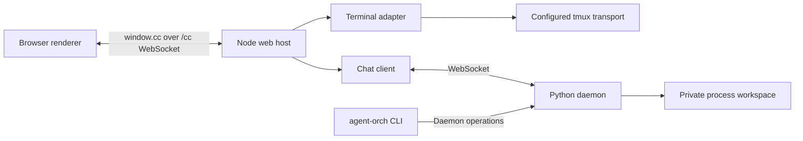

# Pentacle architecture

Pentacle consists of the Python daemon, the `agent-orch` CLI, the process
workspace and Pentacle Web. The Node web host serves the browser renderer and
connects it to terminal attachments and the daemon.

## Process boundaries

| Process or module | Responsibility |
|---|---|
| Web host (`server/`) | configuration, browser authentication, terminal attachments, shared request handlers and the daemon connection |
| Browser renderer (`renderer/`) | terminal grid, sidebar, structured chat, dashboards and browser-local controls |
| Shared host modules (`main/`) | chat client, terminal adapter and handler implementations used by the web host |
| Chat daemon (`services/chat-stream-v2/`) | session inventory and lifecycle, provider operations, transcript events, notifications and persistence |
| `agent-orch` (`services/agent-orch/`) | command-line client for daemon operations |
| Process workspace (`process/`) | portable work specs, lifecycle, development and QA guidance and validation tools |

`agent-orch` is a command-line client, not a background service. The daemon,
CLI and web host can run on one machine; a browser can connect remotely through
an authorized network boundary. Copy the process workspace to a private
location before adding real work or receipts.

## Independent topology axes

The web host resolves terminal targets from its configuration: local,
`remote`, explicit `hosts` entries and `peers[]`. The daemon roster in
`chatStream.hosts` and local/alias mappings must agree with those transports.
The browser machine does not own the host's terminal processes.

Structured chat uses the separate `chatStream.url` connection. A working
terminal attachment does not prove the chat daemon is reachable, or vice versa.

## Request flows

### Structured chat

1. The renderer calls `window.cc`, implemented by `renderer/web_cc.js`.
2. The browser transport sends the request to the web host's `/cc` bridge.
3. `server/ws_bridge.js` dispatches through the table collected from
   `main/cc_handlers.js`; the chat client sends the daemon operation.
4. Replies return to the requesting browser. Transcript and state broadcasts
   are reduced by the renderer store.

### Raw terminal

The renderer requests an attachment through the same bridge. The terminal
adapter selects the configured host transport and creates or attaches a PTY.
Slots are keyed by each connection's `event.sender.id`; terminal output is
sent only to that connection. Socket closure fires its `destroyed` hook to
release attachments. Per-connection PTY limits bound resource use. This path
is separate from structured-chat RPCs.

## Web host and browser boundary

`npm run web` builds the renderer and starts `server/`. The build derives
`renderer/dist/web/web.html` from `renderer/index.html` and bundles browser
entrypoints. The host injects computed configuration as
`window.__PENTACLE_CONFIG__`; `get-config` and `/api/config` strip the daemon
credential and token path before exposing it to the browser.

`renderer/web_cc.js` defines the browser surface. The parity tests compare its
calls with registered handlers and the explicit classifications in
`main/cc_handlers.js`:

- `WEB_LOCAL`: clipboard, external links and reload are answered in the browser.
  The host refuses these channels rather than using its own clipboard.
- `WEB_UNSUPPORTED`: the host refuses context-menu and meeting-window channels;
  the browser supplies an HTML menu or an unavailable-feature notice.
- `UNIMPLEMENTED`: retained channel names have no host handler. The browser
  popout manager handles chat popouts locally; optional dashboard RPCs without
  a public provider remain unavailable.

A loopback bind is single-user and open to clients that can reach it. A routable
bind requires a web-login token. Behind `tailscale serve`, an authenticated
loopback host can instead admit allow-listed Tailscale identities. Authentication
controls who connects; a connected operator has the full supported client
surface. See [web host security and protocol](../server/README.md).

A hosted profile supplies the daemon credential and terminal transports for a
browser-only client. Separate instances can use separate profiles, ports and
login boundaries. [Web host profiles](../configs/README.md) documents the
configuration shape; a profile does not change the daemon's responsibilities.

## Local persistence

Keep daemon databases, blobs, credentials and work receipts outside the public
checkout. Development fixtures should use explicitly owned disposable stores.
The daemon normally binds to `127.0.0.1:7791`, the web host to
`127.0.0.1:7795`, and an optional microphone service may use `127.0.0.1:7780`.
Routable access requires the documented authentication and network boundary.

## Configuration ownership

- [Quick start](../README.md#quick-start) owns the minimal installation flow.
- [Web configuration](desktop_config.md) owns client fields and feature flags.
- [Web host reference](../server/README.md) owns flags, authentication and build.
- [Orchestration setup](agent_orchestration_setup.md) owns machine and CLI setup.
- [Chat protocol](chat_protocol.md) owns the wire contract.
- The [daemon](../services/chat-stream-v2/README.md) and
  [CLI](../services/agent-orch/README.md) READMEs own their implementation commands.
- [Process setup](../process/README.md) owns the portable work process.

This document describes public interfaces and responsibilities, not a particular
fleet, deployment service or credential store.
